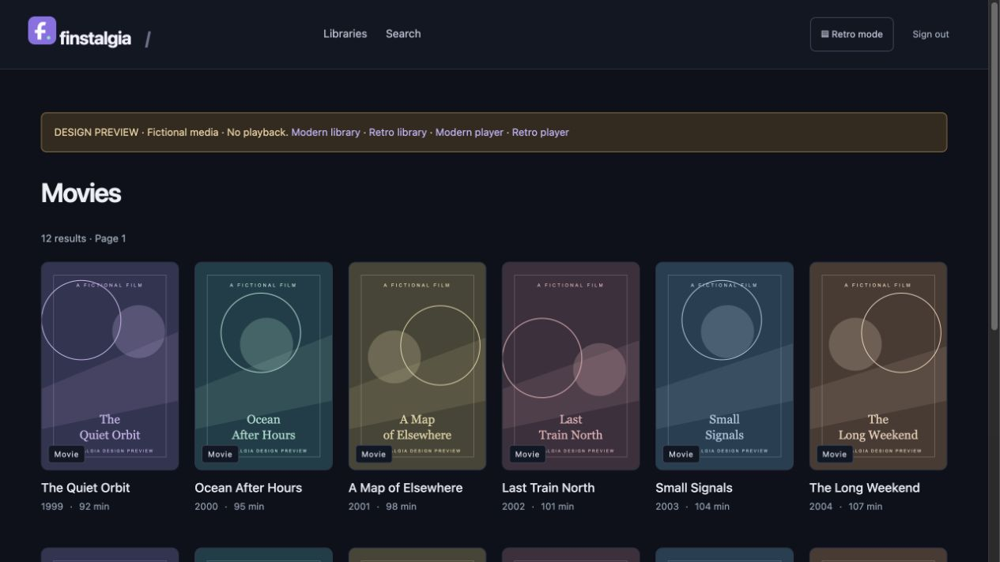
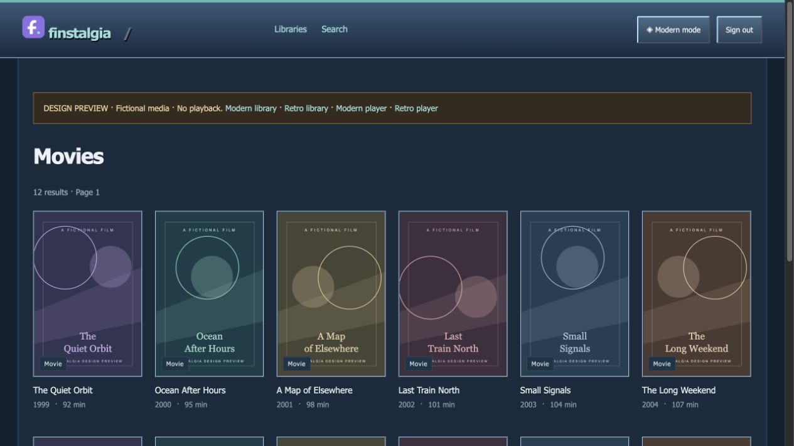

<p align="center">
  
</p>

<h1 align="center">Finstalgia</h1>

A lightweight Jellyfin web client for older iPads. Browse your library and play video through Jellyfin’s H.264/AAC transcoding—no app, jailbreak, or frontend build required.

- **Modern and Retro modes**, with native video controls.
- Movies, TV, search, and 480p/720p/1080p playback at up to 30 fps. 720p is the default.
- Resume playback, continue watching, and watched/unwatched marks synced with Jellyfin.
- Individual Jellyfin accounts, with access tokens kept on the server.

**v0.3.** Built for iPad 2 / iOS 9.3.5. Playback confirmed working by the project owner.

## Screenshots

| Modern mode | Retro mode |
| --- | --- |
|  |  |

*Design previews with fictional media. No video is attached.*

## Install with Docker

Public image: `leodengdev/finstalgia:latest` (AMD64 and ARM64). No Docker login or source build needed.

```sh
mkdir finstalgia && cd finstalgia
curl -fsSLO https://raw.githubusercontent.com/leodenglovescode/Finstalgia/main/compose.yaml
curl -fsSLo .env https://raw.githubusercontent.com/leodenglovescode/Finstalgia/main/deploy/compose.env.example
```

Edit `.env` with your Jellyfin URL and bridge LAN IP, then:

```sh
docker compose pull
docker compose run --rm finstalgia cert-init --ip 192.168.1.20
docker compose up -d
```

Replace the example IP with the bridge’s LAN address. Install its public CA on the iPad as described below, then open `https://YOUR_LAN_IP:18443` and sign in. Pin `FINSTALGIA_IMAGE=leodengdev/finstalgia:0.3.0` in `.env` to stay on this release.

Prefer Python? [Local install and systemd setup](docs/DEPLOYMENT.md).

**HTTP sends passwords and sessions unencrypted.** Use HTTPS for regular LAN use; do not expose Finstalgia to the public Internet.

## HTTPS on your LAN

Export the public certificate and display its fingerprint:

```sh
docker compose cp finstalgia:/config/ca.cer ./finstalgia-ca.cer
docker compose run --rm finstalgia cert-info
```

Transfer `finstalgia-ca.cer` to the iPad and verify its fingerprint before installing it.

- **iOS 9:** install the root certificate/profile, then verify that Safari trusts the exact HTTPS address. It does not have the newer full-trust switch.
- **iOS 10.3+:** after installation, enable the root under **Settings → General → About → Certificate Trust Settings**.

See [certificate setup and troubleshooting](docs/REFERENCE.md#https-and-your-own-local-ca) for transfer options, SANs, clock checks, and custom certificates.

## Deployment

[Docker Compose and Linux systemd setup →](docs/DEPLOYMENT.md)

The Docker image runs as a non-root user and keeps certificates in a persistent volume. Deployment defaults to loopback; LAN access is an explicit setting. Run one instance with one worker. Restarts clear login sessions.

## Status and limitations

Playback works with Jellyfin transcoding. Progress saves about every 10 seconds and on pause, using a small iOS 9-compatible script; browsing, playback, and manual watched marks work without JavaScript. Hardware acceleration is configured in Jellyfin. Subtitle/audio selection, offline playback, and DRM are not supported.

[Device checklist](docs/DEVICE_CHECKLIST.md) · [Technical reference](docs/REFERENCE.md) · [Security](SECURITY.md) · [Contributing](CONTRIBUTING.md)

[MIT license](LICENSE)
